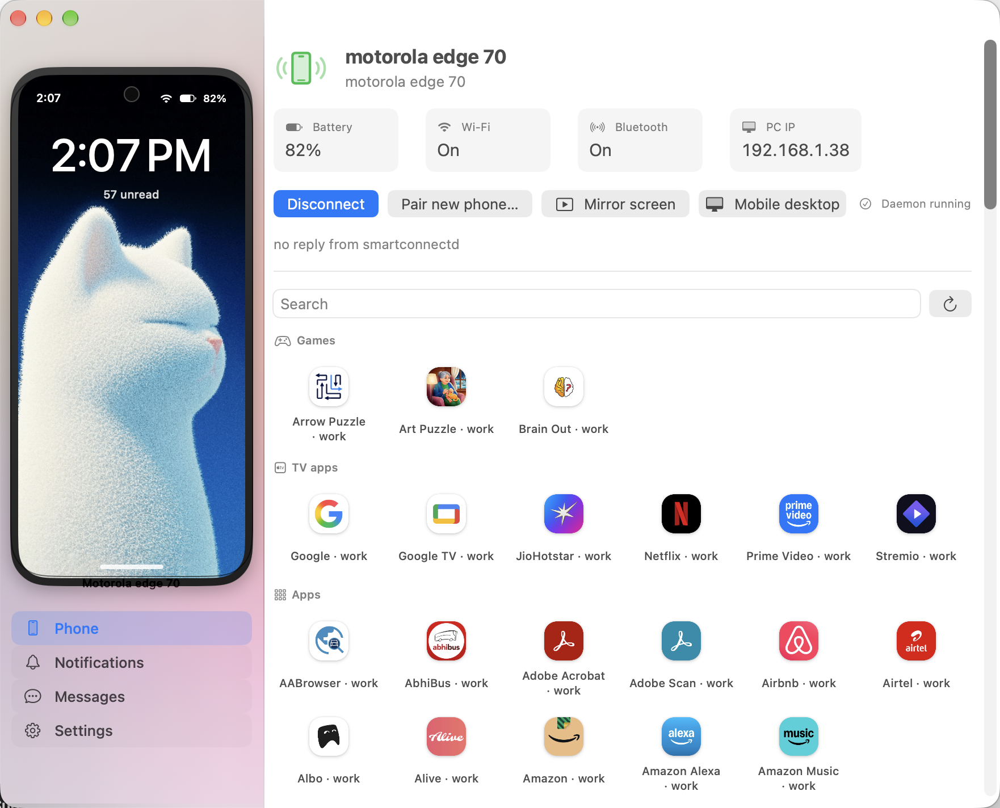
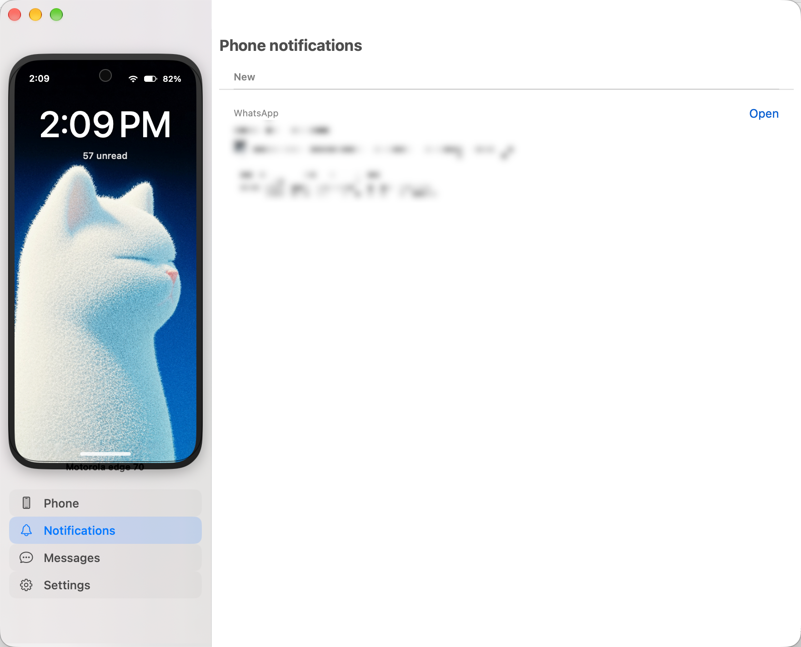
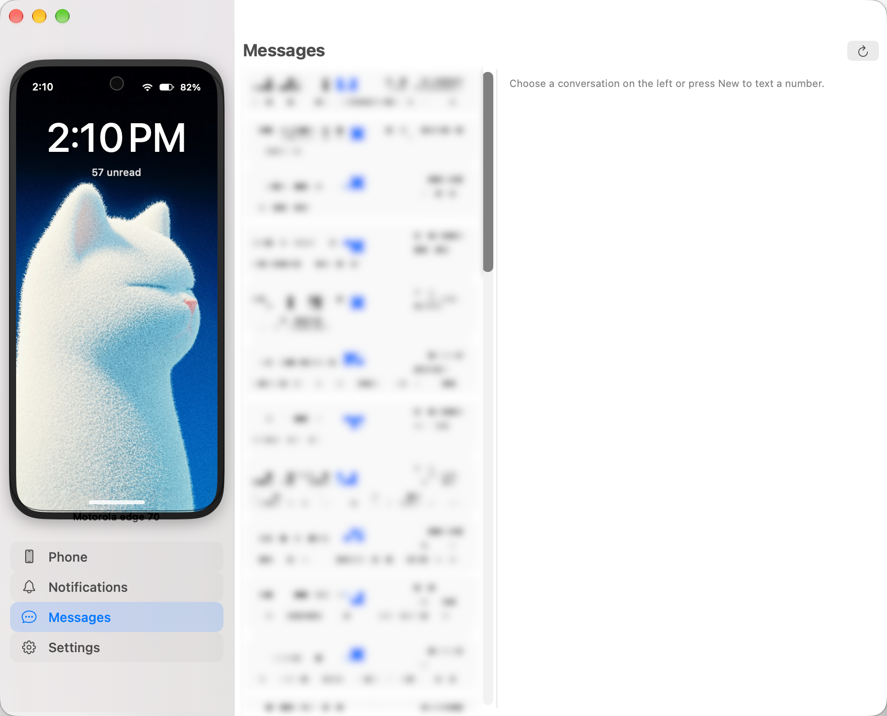
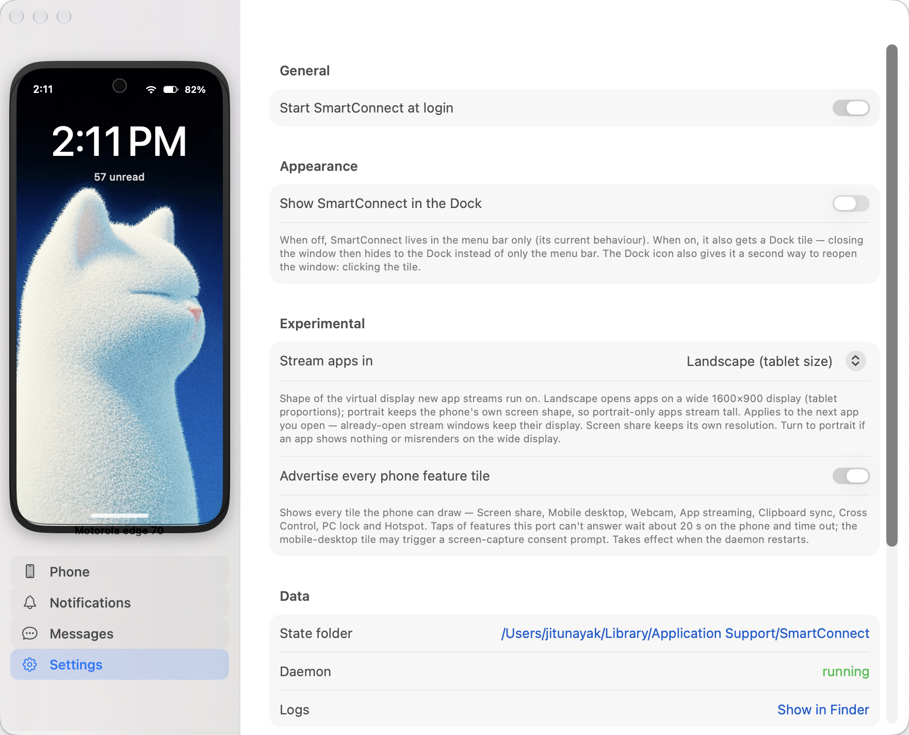
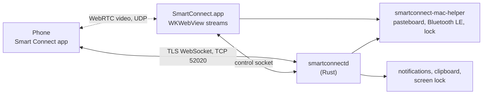

# smart-connect-mac

**Use Motorola's Smart Connect with your Mac.**

smart-connect-mac makes a Mac show up in Motorola's **Smart Connect** phone app as if it were a
Windows PC. The phone runs the stock, unmodified app: no root, no extra app, no developer options.
Pair once by scanning a QR code, and you get:

- phone **notifications** on the Mac, with quick reply and action buttons
- **Copy OTP** — a one-time code in a notification copies itself to the Mac, banner hidden
- **SMS** in a Messages page: threads, conversation view, send, mark read
- **iPhone-style calling** — a ringing card for incoming calls and a menu-bar call pill with
  live timer, mute, speaker and end
- clipboard sync, both ways
- **screen mirroring** and phone apps in their own Mac windows (tablet-sized 1600×900 streams)
- the phone's app grid with **Games / TV apps / Apps** sections, like the phone's own picker
- the phone's **PC lock** and **Hotspot** feature tiles
- automatic reconnect over Wi-Fi, and a Bluetooth LE wake for a backgrounded phone

It is a native Swift menu-bar app (`SmartConnect.app`) wrapping the same Rust daemon
(`smartconnectd`) that the [Linux project](#credits) uses, plus a small Swift helper for the pieces
a CLI cannot do on macOS (pasteboard, Bluetooth LE, screen lock).

> **Unofficial project.** Not affiliated with, endorsed by or sponsored by Motorola or Lenovo. See
> the [disclaimer](#disclaimer).

| Phone | Notifications |
|---|---|
|  |  |

| Messages | Settings |
|---|---|
|  |  |

## Contents

1. [Install](#install)
2. [Connect](#connect)
3. [Feature status](#feature-status)
4. [Streams](#streams)
5. [Copy OTP](#copy-otp)
6. [Calling](#calling)
7. [Settings](#settings)
8. [Build from source](#build-from-source)
9. [Requirements](#requirements)
10. [How it works](#how-it-works)
11. [Documentation](#documentation)
12. [Known limitations](#known-limitations)
13. [Disclaimer](#disclaimer)
14. [Credits](#credits)
15. [License](#license)

<a name="install"></a>
<details open>
<summary><h2>Install</h2></summary>

1. Download **`SmartConnect-0.1.0.dmg`** from the
   [v0.1.0 release](https://github.com/jitunayak/smart-connect-mac/releases/tag/v0.1.0).
2. Open the disk image and drag **SmartConnect** into **Applications**.
3. Launch it. It has no Dock icon by default and lives in the **menu bar** (click the phone glyph
   to open the panel, or *Open* to show the main window).

macOS asks for **Local Network** access the first time — allow it, or the phone cannot be found.
Allow **Bluetooth** too if you want the phone to be woken while Smart Connect is in the background.

> **Gatekeeper note.** The app is ad-hoc signed, not notarised. If macOS refuses the first launch,
> right-click the app → **Open**, or run
> `xattr -d com.apple.quarantine /Applications/SmartConnect.app`.
> Requires macOS 13.0 or newer on Apple Silicon.

</details>

<a name="connect"></a>
<details>
<summary><h2>Connect</h2></summary>

The phone, the Mac and the daemon all need to be on the same Wi-Fi network and subnet (discovery
uses mDNS).

1. **Pair.** In the app, open the menu-bar panel and press **Pair new phone...** (or the equivalent
   in the main window). A QR code appears. On the phone, open **Smart Connect**, tap **+**, choose
   **Scan QR code** and scan it. The Mac then appears in the phone's device list.
2. **Connect.** The first connection happens right after pairing. Afterwards, tap **Connect** on the
   Mac's tile in the phone app, or press **Connect** in the menu-bar panel. The daemon also
   reconnects on its own after drops and restarts.
3. **Use it.** Copy text on either side and watch notifications arrive, press **Mirror screen**,
   stream an app from the grid, read or send an SMS in **Messages**, or lock the PC from the
   phone's own Smart Connect tile.

</details>

<a name="feature-status"></a>
<details>
<summary><h2>Feature status</h2></summary>

Key: ✅ verified on a real phone · 🟡 implemented, not verified on a device yet · ❌ not supported on
macOS

Tested with a **motorola edge 70** running the stock Smart Connect app, over LAN, on macOS 13 or
newer (Apple Silicon). Other phones and app versions may behave differently. The macOS port shares
its protocol work with the Linux project, so details on each service live in the
[protocol notes](docs/protocol/README.md).

**Connection**

| Feature | Status | Notes |
|---|---|---|
| Pairing by QR code | ✅ | Scan a QR from the Smart Connect app; the Mac then appears in the phone's device list. |
| Reconnect over Wi-Fi (mDNS) | ✅ | The phone's Connect button, and the daemon dialing the phone back. |
| Automatic reconnect | ✅ | After drops, at startup and after a failed Connect, with the phone's app in the background or open. |
| Bluetooth LE wake | 🟡 | A native helper advertises the ReadyFor GATT service and writes the wake frame, so a desktop Connect reaches a backgrounded Smart Connect app. |
| Feature tiles for this Mac on the phone | ✅ | Screen share / Mobile desktop, App streaming, Clipboard sync, PC lock and Hotspot are advertised by default. |

**Notifications, clipboard and messages**

| Feature | Status | Notes |
|---|---|---|
| Phone notifications with quick reply | ✅ | Shown in the menu-bar panel, the Notifications page and as macOS banners. Reply from the panel or the window. |
| Copy OTP | ✅ | A one-time code in a notification (or an SMS) copies itself to the Mac's pasteboard on arrival while the banner hides the code behind bullets; *Copy OTP* stays as a fallback. See [Copy OTP](#copy-otp). |
| Notification action buttons ("Mark as read", ...) | 🟡 | Sent to the phone through a short, windowless app-streaming session, as the Windows app does. |
| Open on phone | 🟡 | Opens the app in a streamed window for apps that have no reply action. |
| Clipboard text, both ways | ✅ | Password-manager copies (concealed pasteboard types) are never sent to the phone. |
| SMS (threads, conversation, send, mark read) | 🟡 | The **Messages** page lists conversations, shows received/sent bubbles, sends through the phone and opens (marks read) a thread. |
| Calling UI | 🟡 | Ringing / ongoing cards, Accept · Decline · Silence, and the menu-bar call pill. See [Calling](#calling). |

**Mirroring and app streaming**

| Feature | Status | Notes |
|---|---|---|
| Screen mirroring with mouse and keyboard input | ✅ | Menu-bar panel or Phone page → **Mirror screen**. Verified: video plus mouse, wheel and keyboard control. |
| App streaming started from the Mac | ✅ | Each phone app opens in its own window. |
| Tablet-sized app streams (1600×900) | ✅ | Verified: the phone reports landscape 1600×900 displays for streamed apps (Calendar, Gmail, Instagram). See [Streams](#streams). |
| Games / TV apps / Apps sections | ✅ | The app grid is grouped like the phone's own app-stream picker. See [Streams](#streams). |
| Real app icons | ✅ | Downloaded from the phone and cached under `~/Library/Caches/SmartConnect/app-icons`. |
| Running streams list with Close | ✅ | Streams started from the phone (tile taps) and from the Mac appear in the same list. |
| Mobile desktop (Ready For) | 🟡 | Reachable from the panel; not verified on a device. |

**Phone feature tiles**

| Feature | Status | Notes |
|---|---|---|
| PC lock tile | ✅ | Locks the session through the helper (screen-lock state is streamed so the phone's tile updates). |
| Hotspot tile | 🟡 | The phone starts a hotspot with PC-chosen credentials. |
| Webcam, Cross Control, phone as a display | ❌ | Linux-only features; not implemented on macOS. |

</details>

<a name="streams"></a>
<details>
<summary><h2>Streams</h2></summary>

The **Phone** page (and the menu-bar panel) carries the streaming controls:

- **Mirror screen** and **Mobile desktop** buttons start a whole-screen stream.
- **Running streams** lists everything currently streaming, with a **Close** button per row (which
  releases the phone's virtual display).
- The **app grid** shows every app on the phone with its real launcher icon and a search box, plus a
  **Refresh** button that re-requests the list.

The grid is grouped the way the phone's own app-stream picker is:

- **Games** — matched by common game studios and game words (`puzzle`, `quiz`, `brain`, `sudoku`,
  `ludo`, `2048`, `chess`, ...).
- **TV apps** — the video-streaming set (Netflix, Prime Video, Google TV, JioHotstar, Stremio, ...)
  and anything with "tv" in its name.
- **Apps** — everything else.

Headers are hidden when no game or TV app is installed. The phone's app list carries no category
field, so apps are grouped client-side; search always covers the whole list, so a specific app is
one search away.

**Tablet-sized streams.** By default a streamed app opens on a landscape **1600×900** virtual
display at 160 dpi, so wide apps render like a tablet instead of the phone's portrait shape. Switch
*Settings → Experimental → Stream apps in* to **Portrait (phone shape)** if an app misrenders on the
wide display — already-open streams keep their display, and Screen share always keeps its own
mirroring geometry.

</details>

<a name="copy-otp"></a>
<details>
<summary><h2>Copy OTP</h2></summary>

When an SMS — or any app notification — carries a one-time code, the Mac handles it by itself:

- the notification is **sensitive**: its banner shows the digits as bullets, so no code is ever
  on screen,
- the code is read from the phone's **Messages** (the conversation behind the sender, else the
  conversation whose last message carries exactly that code, else the notification's own text)
  and lands on the Mac's pasteboard as the notification arrives,
- a short **OTP copied** follow-up says the code is on your clipboard — by name, but never its
  digits,
- the notifications rows in the panel and the Notifications page still show a copy pill next to
  Reply / Open, and the banner keeps **Copy OTP** as a fallback for the rare missed copy (it
  reads the code from the notification, not from the screen),
- and the Messages page shows a **Copy code** banner above a conversation, with a code chip on the
  message itself.

Copying is local — the notification is *not* opened on the phone or marked handled. A code is
recognised when a keyword (`otp`, `passcode`, `password`, `pin`, `code`) sits within 40 characters
of a 4–8 digit group, or when the body is just the digits; a code read out of Messages is used
only when it agrees with the one the notification carried.

</details>

<a name="calling"></a>
<details>
<summary><h2>Calling</h2></summary>

Calls are presented iPhone-style:

- an incoming call shows an always-on-top **ringing card** — round caller photo, name and an
  *Incoming call* line, with a **Silence** link and round red **Decline** / green **Accept**
  circles — instead of a plain system banner;
- once the call is picked up the card turns into an **ongoing call** bar with a live timer and a red
  **End** circle, and a **menu-bar call pill** appears (red when ringing, green with a running timer
  when in a call) whose popover carries the caller's name, the dialer's detail line, a timer, and
  **Mute**, **Speaker** and **End** buttons.

Mute mutes the Mac's default input (a real mic mute for a Bluetooth-HFP-routed call); Speaker pushes
the Mac's output volume to maximum while on and restores the previous level when off.

Call audio itself rides **Bluetooth HFP** — pair the phone with the Mac the way Windows' Phone Link
does; the protocol side only delivers call *state*.

</details>

<a name="settings"></a>
<details>
<summary><h2>Settings</h2></summary>

The Settings page has:

- **Start SmartConnect at login**.
- **Show SmartConnect in the Dock** — off by default (menu bar only); on gives the app a Dock tile.
- **Stream apps in** — *Landscape (tablet size)* (default) or *Portrait (phone shape)*. See
  [Streams](#streams).
- **Advertise every phone feature tile** — advertise every tile the phone can draw, including ones
  this release cannot answer (their taps wait about 20 s on the phone and time out).
- **Data** — the state folder (`~/Library/Application Support/SmartConnect`), the daemon's running
  state, and a **Show in Finder** shortcut for the logs.

Local data lives under:

| Path | What |
|---|---|
| `~/Library/Application Support/SmartConnect/` | keys, pairing state, saved wallpaper, session logs |
| `~/Library/Caches/SmartConnect/app-icons/` | the phone's launcher icons |
| `~/Library/Caches/SmartConnect/apps-cache.json` | the cached app list |

</details>

<a name="build-from-source"></a>
<details>
<summary><h2>Build from source</h2></summary>

```sh
git clone https://github.com/jitunayak/smart-connect-mac.git
cd smart-connect-mac
./macapp/build.sh --install     # builds the daemon + helper + app, copies to /Applications, launches
```

`build.sh` builds the Rust daemon in release mode, compiles the Swift helper and the menu-bar app,
assembles `build/SmartConnect.app`, ad-hoc signs it and (with `--install`) copies it into
`/Applications`. `--run` launches a local build without installing; with no argument it just builds
`build/SmartConnect.app`.

**Requirements**

- macOS 13.0 or newer on Apple Silicon (the app targets `arm64-apple-macosx13.0`).
- Xcode **Command Line Tools** (for `swiftc`).
- A **Rust** toolchain (from <https://rustup.rs>) with `cargo` on `PATH`.
- Same Wi-Fi network and subnet as the phone; inbound TCP 52020 and mDNS (UDP 5353) reachable on the
  Mac. macOS must be allowed to grant **Local Network** and **Bluetooth** access.

</details>

<a name="requirements"></a>
<details>
<summary><h2>Requirements</h2></summary>

- A Motorola phone with the **Smart Connect** app, on the same Wi-Fi network and subnet as the Mac.
- macOS 13.0 or newer, Apple Silicon.
- Local Network permission (discovery/connection use mDNS and a LAN TCP port). Bluetooth permission
  if you want the Bluetooth LE wake.

</details>

<a name="how-it-works"></a>
<details>
<summary><h2>How it works</h2></summary>

The phone connects to `smartconnectd` over a TLS WebSocket, exactly as it would to the Windows app.
The daemon handles pairing, notifications, clipboard, SMS and phone status itself, and drives the
feature tiles. The menu-bar app talks to the daemon over a local control socket and hosts the
WebRTC streams in `WKWebView`s; the helper covers the macOS-only bits.



More in [Architecture](docs/architecture.md) and the [protocol notes](docs/protocol/README.md).

</details>

<a name="documentation"></a>
<details>
<summary><h2>Documentation</h2></summary>

The macOS app wraps the same daemon and protocol as the Linux project, so most of the design notes
apply to both. The protocol pages are the most useful:

- [Documentation index](docs/index.md)
- [Protocol notes](docs/protocol/README.md): the Smart Connect wire protocol, one page per service
- [Usage](docs/usage.md): every feature and the command-line reference (Linux front-ends)
- [Architecture](docs/architecture.md)
- [Control socket API](docs/control-socket-api.md)
- [Security](docs/security.md)
- [Changelog](CHANGELOG.md)

Protocol pages by service:
[app streaming](docs/protocol/app-streaming.md) ·
[notifications](docs/protocol/notifications.md) ·
[SMS](docs/protocol/sms.md) ·
[mirroring](docs/protocol/mirroring.md) ·
[device status and tiles](docs/protocol/device-status-and-tiles.md) ·
[pairing and discovery](docs/protocol/pairing-and-discovery.md) ·
[clipboard](docs/protocol/clipboard.md) ·
[PC lock](docs/protocol/pc-lock.md).

</details>

<a name="known-limitations"></a>
<details>
<summary><h2>Known limitations</h2></summary>

- **Only one phone at a time.** The daemon pairs and connects a single phone; disconnect it before
  pairing another.
- **Webcam, Cross Control and phone-as-a-display are not implemented on macOS.** Those features
  live in the Linux project. The tiles can still be advertised (they time out on the phone).
- **The webcam and image/file clipboard are not available.** Text clipboard sync works both ways;
  images and files are not fetched yet.
- **PC audio on the phone is not implemented.** Call audio rides Bluetooth HFP instead.
- **Messaging notifications show the app icon, not the sender's picture**, because the phone sends
  only its owner's picture for a chat.
- **The Bluetooth LE wake can take a few retries** while the phone is far from the Mac, and the
  daemon never switches Bluetooth on or off.
- **A future phone app update may break the protocol**, which was worked out through clean-room
  analysis.

</details>

<a name="disclaimer"></a>
<details>
<summary><h2>Disclaimer</h2></summary>

smart-connect-mac is an independent, unofficial project. It is not affiliated with, endorsed by or
sponsored by Motorola or Lenovo. Motorola, Smart Connect, Ready For and related names and logos are
trademarks of their respective owners. They are used here only to say what this software works with.

The project exists for interoperability: it lets Macs talk to the Smart Connect app that is already
on your phone. The protocol was worked out through clean-room protocol analysis. This repository
contains no Motorola code or binaries. Using this software is at your own risk, and a future phone
app update may break it.

</details>

<a name="credits"></a>
<details>
<summary><h2>Credits</h2></summary>

The daemon and the protocol work come from the upstream Linux project,
[rudrahnpatel/smartconnect-linux](https://github.com/rudrahnpatel/smartconnect-linux), which makes a
Linux desktop look like a Windows PC to the same phone app. This repository adds a native macOS
menu-bar app, the macOS helper and the app-side features described above.

</details>

<a name="license"></a>
<details>
<summary><h2>License</h2></summary>

MIT. See [LICENSE](LICENSE).

</details>
